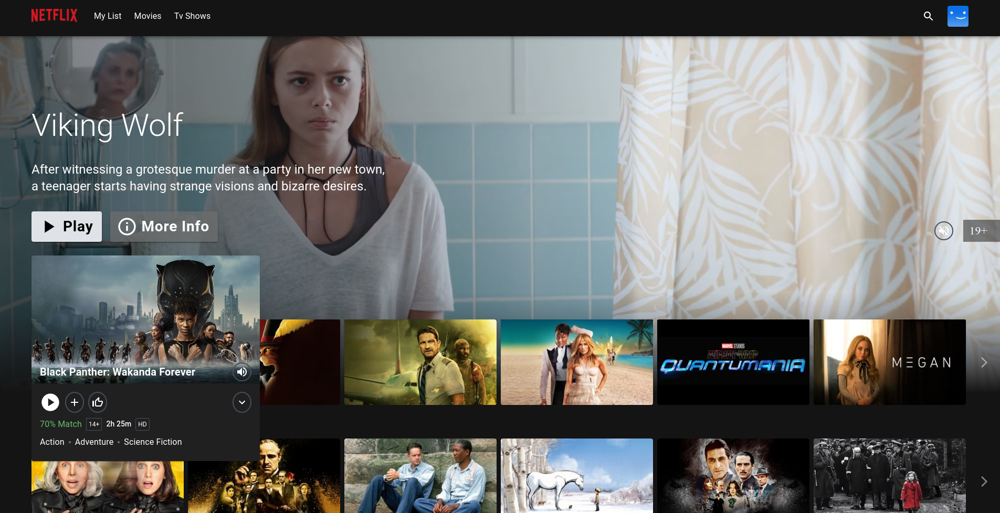
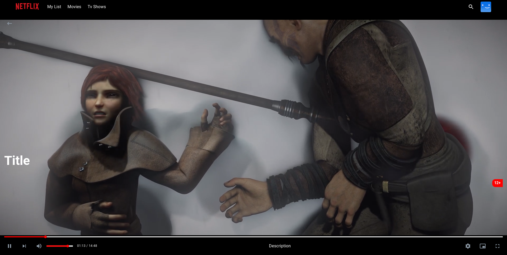

<div align="center">
  <a href="http://netflix-clone-with-tmdb-using-react-mui.vercel.app/">
    
  </a>

  <h1 align="center">Netflix Clone</h1>

  <p align="center">
    <a href="https://netflix-clone-react-typescript.vercel.app/">View Demo</a>
    ·
    <a href="https://github.com/crazy-man22/netflix-clone-react-typescript/issues">Report Bug</a>
    ·
    <a href="https://github.com/crazy-man22/netflix-clone-react-typescript/issues">Request Feature</a>
  </p>
</div>

## Project Structure

```text
Netflix-Clone/
├── backend/   - Node.js/Express API
├── frontend/  - React/Vite application
├── .gitignore
└── README.md
```

## Backend Setup

```bash
cd backend
npm install
npm start
```

### Backend Environment Variables

Create `backend/.env` based on `backend/.env.example`:

```env
PORT=5000
NODE_ENV=development
```

## Frontend Setup

```bash
cd frontend
npm install
npm run dev
```

### Frontend Environment Variables

Create `frontend/.env` based on `frontend/.env.example`:

```env
VITE_APP_TMDB_V3_API_KEY=your_tmdb_api_key_here
VITE_APP_API_ENDPOINT_URL=https://api.themoviedb.org/3
```

## Production Build

```bash
cd frontend
npm run build
```

---

<details>
  <summary>Table of Contents</summary>
  <ol>
    <li>
      <a href="#prerequisites">Prerequisites</a>
    </li>
    <li>
      <a href="#which-features-this-project-deals-with">Which features this project deals with</a>
    </li>
    <li><a href="#third-party-libraries-used-except-for-react-and-rtk">Third Party libraries used except for React and RTK</a></li>
  </ol>
</details>

<br />

<div align="center">
  
  <p align="center">Home Page</p>
  
  <p align="center">Mini Portal</p>
  
  <p align="center">Detail Modal</p>
  
  <p align="center">Grid Genre Page</p>
  
  <p align="center">Watch Page with custom control bar</p>
</div>

## Prerequisites

- Create an account if you don't have one on [TMDB](https://www.themoviedb.org/) to consume movie/tv data.
- Follow the [documentation](https://developers.themoviedb.org/3/getting-started/introduction) to create an API Key.
- In `frontend/`, copy `.env.example` to `.env` and paste your TMDB API Key.

## Which features this project deals with

- Custom Hooks
- Context and Providers
- Lazy loading and Suspense for Code-Splitting
- React Router route lazy loading and data loaders
- Portals and Forwarding Refs
- Higher-Order Components (HOC)
- Customizing MUI Default Theme & Classnames
- RTK & RTK Query
- Infinite Scrolling (using Intersection Observer API)
- Slick Carousel

## Third Party libraries used

- [react-router-dom@v6.9](https://reactrouter.com/en/main)
- [MUI (Material UI)](https://mui.com/)
- [framer-motion](https://www.framer.com/docs/)
- [video.js](https://videojs.com)
- [react-slick](https://react-slick.neostack.com/)
